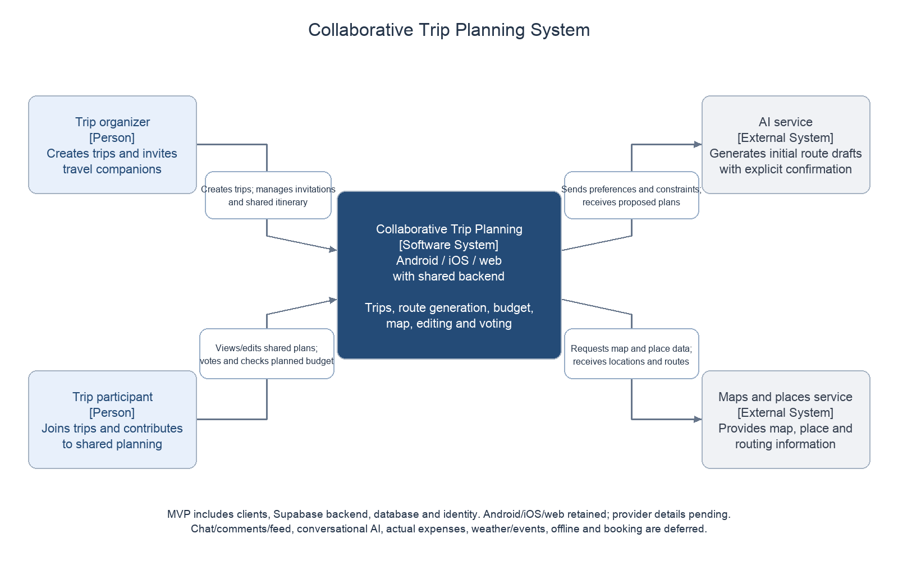

# Architecture Diagrams

## MVP revision 23 October 2026

The [Use Case source](use-case.drawio) now contains MVP core and budget/voting pages: [core PNG](use-case-core.png), [budget/voting PNG](use-case-collaboration.png), [combined PNG](use-case.png). The filename of the second preview is retained for existing links; its contents no longer promise community features.

The [overall Component source](overall-components.drawio) and [PNG](overall-components.png) show explicit Zukhra/Yerassyl/Sayakhat ownership and the five-function scope. Generated PNG previews and editable XML share definitions; no native draw.io export is claimed.

Existing backend/context/ER views below are retained as teammate design work and may still include deferred tables/features. Yerassyl must align their MVP/deferred labels before final submission. See [scope revision](../docs/mvp-scope-and-responsibilities.md), [architecture](../docs/architecture-and-use-cases.md) and [requirements](../docs/requirements-specification.md).

## Earlier diagram contribution and verification record

## Integrated Views Added 22 October 2026

- [Use Case source — two editable pages](use-case.drawio): [core PNG](use-case-core.png), [collaboration/community PNG](use-case-collaboration.png), [combined PNG](use-case.png).
- [Overall Component source](overall-components.drawio) and [PNG](overall-components.png).
- [Overall architecture](../docs/architecture-and-use-cases.md), [requirements](../docs/requirements-specification.md) and [whole-team verification plan](../docs/verification-and-evaluation-plan.md).

The integrated views cover Android/iOS plus web from one Flutter codebase, selected Supabase and the existing backend/database contribution. Chat and the post feed are in scope; optional expenses/offline viewing and later weather/event integrations are labeled. PNGs are generated readable previews from the same definitions; editable sources are retained. No deployed services or executed test results are implied. The earlier backend contribution below retains its authorship and historical verification notes.

## System Context

Open `system-context.drawio` in diagrams.net using **File → Open From → Device** to edit the diagram. `system-context.png` is the matching preview generated from the same node and relationship definitions. The source XML has been parsed successfully and the PNG visually inspected; all five pages across the three source files were opened and visually checked in the draw.io editor on 20 October 2026.

The diagram describes the proposed system, not a deployed implementation. The organizer creates trips and manages members; participants contribute according to their assigned permissions. The web client, mobile client, shared backend, database and identity functions are inside one logical software-system boundary. Internal components will be detailed separately in the Component Diagram.

The external AI service returns draft plans or suggested changes. The application must validate proposals and obtain user confirmation before saving them. The external maps and places service supplies map, place and routing information; specific providers and API coverage remain to be selected and checked. Bidirectional arrows summarize requests and responses rather than individual endpoints.

Supabase is the selected implementation platform within the system boundary, so it is not shown as a separate user-facing external system. Weather, events and other integrations will be added only when requirements and providers are confirmed. Wanderlog is a product reference, not an API dependency.

The diagram follows the supplied work plan and the team's confirmation that both web and mobile clients are in scope. Check it against the final requirements with Zukhra and Sayakhat before marking architecture review complete.

## Database ER Diagram

Open [database-er.drawio](database-er.drawio) for four editable domain pages. PNG previews:

- [Membership and expenses](er-membership-expenses.png)
- [Itinerary and voting](er-itinerary-voting.png)
- [Communication and community](er-communication-community.png)
- [AI proposals](er-ai-proposals.png)

The revised 15-table model is generated from [schema-design.json](../config/schema-design.json) using [render_schema_design.py](../scripts/render_schema_design.py). See [schema alignment](../docs/schema-alignment.md) for role, invitation, event, feed and confirmation contracts.

See [database design](../docs/database-design.md) for keys, constraints, access rules and assumptions. This is a proposed schema; no database has been deployed. PNGs and editable pages share schema definitions but PNGs were generated separately, not exported through draw.io.

## Backend Component Diagram

- [PNG preview](backend-components.png)
- [Editable draw.io source](backend-components.drawio)
- [Responsibilities and workflows](../docs/backend-component-design.md)

This is the backend/database contribution for the team's combined Component Diagram. Client internals and the map integration are included in the overall Component view; interface review and implementation remain pending. No deployment or runtime validation is implied.

## MVP scope revision, 23 October 2026

Backend/context and all four ER views now distinguish the five-function MVP from retained future design. All 15 tables remain; eight support MVP and seven are deferred. The generation proposal table supports initial drafts and explicit confirmation, not a conversational assistant. Android/iOS/web are retained. No diagram demonstrates deployment.

Reproduce ER source/PNGs with `python3 scripts/render_schema_design.py`; reproduce context/backend PNGs from their native editable XML using `python3 scripts/render_architecture.py` (Pillow and system Arial font required). Team-owned overall Component/Use Case changes stay in PR #10. Review the [server contract proposal](../docs/mvp-server-contract.md) before integration.
