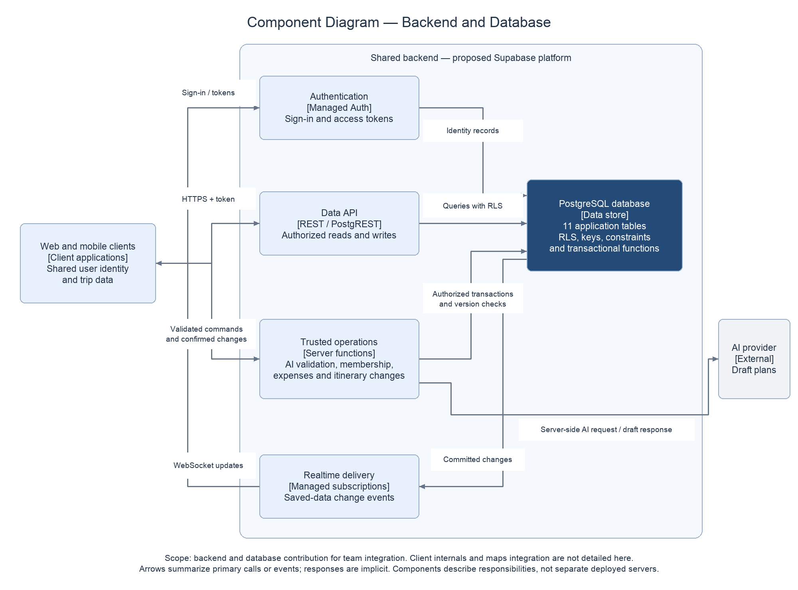

# Backend Component Design

This proposed design describes Yerassyl's backend and database contribution. It is intended for integration with Zukhra's overall architecture and Sayakhat's client and AI workflows. Supabase remains the recommended platform pending team review and the proof of concept described in the technology comparison. No services have been deployed.

## Diagram

[Editable draw.io source](../diagrams/backend-components.drawio). The source XML has been parsed and the PNG visually checked. The PNG was generated from the same definitions rather than exported through draw.io; the source was also opened and visually checked in draw.io on 20 October 2026. This is a component-oriented backend view, not a complete deployment diagram or the final whole-system Component Diagram.

## Responsibilities

| Component | Responsibility and boundary |
|---|---|
| Web and mobile clients | Present planning workflows and hold the user's session. They call the same backend. Client-side checks improve usability but do not establish permission |
| Authentication | Managed sign-in and token issuance. Application profile IDs correspond to identity records; authentication does not automatically grant trip membership |
| Data API | Policy-protected ordinary reads and writes through REST. Exposed tables require RLS and explicit grants. Complex operations must not be bypassed by direct table writes |
| Trusted operations | Server functions authorize membership changes, expense updates, itinerary edits and AI requests. They invoke transactional database functions where multiple records must change atomically |
| PostgreSQL | Stores the 11 application tables in the ER model and managed identity records separately. Enforces keys, constraints and policies; database functions implement atomic multi-record operations |
| Realtime delivery | Sends permitted change notifications to subscribed clients after persistence. The database remains authoritative; subscriptions are not durable message history |
| External AI provider | Receives a controlled planning request and returns untrusted draft content. Credentials stay in server configuration; the provider has no direct database access |

These are logical responsibilities. A single server-functions codebase may initially implement the trusted operations; the diagram does not require a separate microservice for each responsibility. Authentication, Data API and Realtime are managed platform services. PostgreSQL identity schemas are not additional application-domain tables in the ER count.

## Main workflows

### Reading and updating trip data

The client signs in and supplies its token on data requests. Policies check active membership and role for the requested trip. Ordinary permitted records may use the Data API directly. Operations affecting ownership, expense totals or itinerary order must pass through a protected command and an atomic database transaction. Restrict direct writes to those records so clients cannot bypass invariant checks.

### Saving chat messages and notifying participants

An active member sends a message with a stable client_message_id. The authorized write persists it once, using the unique key described in the ER model. Realtime then delivers permitted change events. Clients deduplicate by record ID and reload stored history after reconnection. A missing WebSocket event must not lose a saved message.

### Generating and confirming an AI plan

The server checks the requester and trip, loads relevant places and constraints, and calls the AI provider. It validates the draft's place references, schedule and budget before returning it for preview. The existing saved itinerary remains unchanged. When the user confirms, the server rechecks permission and the current itinerary version and saves the valid changes atomically. Reject stale or invalid proposals. AI conversation and draft persistence are not part of the current ER schema and require an explicit extension if needed.

### Membership and expenses

A protected operation handles accepted membership and ownership changes. Historical membership records remain available for linked messages and financial records; inactive users must lose access. Expense updates validate the payer, participating users, trip currency and exact sum of shares before committing. The role and invariants must be enforced within the trusted transaction, including when the server uses a privileged database connection.

## Consistency with other documents

The System Context Diagram includes clients and backend inside one logical system boundary. This view expands only the backend part. The ER model supplies the application tables used by PostgreSQL. The technology comparison supplies the rationale for REST, managed subscriptions and PostgreSQL.

The context diagram's maps/places provider is omitted here because this contribution does not finalize client map rendering or the provider integration. The team must add the chosen map integration to the combined component view; any private provider credentials and quotas require server-controlled access as appropriate. Wanderlog remains a product reference, not an integrated dependency.

## Review and verification still required

- Zukhra: confirm overall component boundaries and integration with requirements.
- Sayakhat: confirm web/mobile contracts, map integration and AI input/output structure.
- Yerassyl: implement and test RLS, command authorization, atomic invariants, duplicate handling and reconnect recovery.
- Check that inactive members cannot access reads or updates, privileged commands cannot bypass business rules, and invalid AI drafts cannot overwrite a saved plan.
- Confirm function execution limits and workload suitability before selecting the final server runtime. Add a dedicated service only if requirements or measurements justify it.

These are planned checks. No runtime, security or performance tests have been completed for this design.
