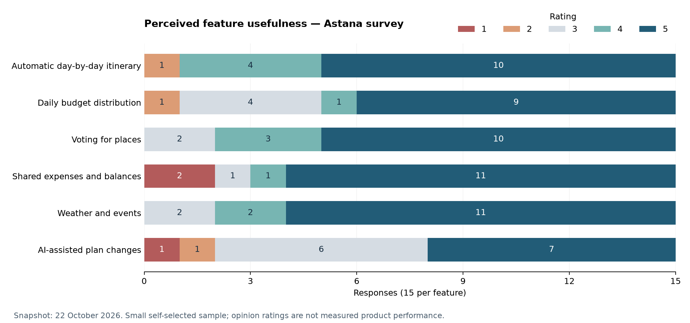

# Astana Resident Survey Results

**Owner:** Kabysheva Zukhra · **Snapshot inspected:** 22 October 2026  
**Task:** [DIP-5](https://dip-trip-planner.youtrack.cloud/issue/DIP-5)  
**Evidence:** 15 submitted Google Forms responses; descriptive preliminary findings, not a representative population study.

## 1. Purpose and Method

The Russian/Kazakh questionnaire collects residents' place suggestions, travel-planning practices, reported group-planning difficulties and perceived usefulness of proposed features. The form title is translated here as “Opinions of Astana Residents”. The aggregate JSON uses English translations of the original questionnaire labels; counts are unchanged. The visible summary showed 15 responses when inspected on 22 October 2026. This is a snapshot, not a claim that collection has closed. Actual launch/closing dates and recruitment reach have not been established from the summary.

Counts were transcribed from the visible chart data tables and cross-checked for totals. Public evidence contains only aggregated counts and a normalized candidate-place list. Names, contacts, individual timestamps, account details, response-sheet links and participant-level answers are not included. The [aggregate data file](survey-aggregate-data.json) supports checking the calculations. Interviews are not used in this report.

Submitted answers are self-reports; identity, unique-person status and residence have not been independently verified. No generated or test answers were added for this analysis. The sample is small and non-probabilistic; one response changes a percentage by approximately 6.7 points. Reported usefulness is not proof of adoption, usability or product performance.

## 2. Sample and Current Practices

All denominators below are 15 unless otherwise indicated.

| Question | Observed distribution |
| --- | --- |
| Residence in Astana | Less than one year: 0; one to under three years: 8; three to ten years: 1; over ten years but not since birth: 5; since birth: 1. |
| Age | Under 18: 1; 18–24: 14; all older categories: 0. Do not generalize this sample to older travelers. |
| Travel frequency | Several times per year: 8; once per year: 5; less often: 2; almost never: 0. |
| Usual companions | Friends: 6; family/children: 9; solo, couple and colleagues categories: 0. This question's displayed pie chart sums to 15; it is not analyzed as a multiple-choice selection count. |
| Estimated ordinary cafe meal per person | Under 3,000 KZT: 0; 3,000–4,999: 9; 5,000–7,999: 5; 8,000–12,000: 1; above 12,000: 0. These are perceptions, not verified current menu prices. |

### Planning Tools

This question permits multiple selections, so percentages need not sum to 100%.

| Tool | Responses | Share |
| --- | --- | --- |
| Instagram/TikTok | 14 | 93.3% |
| 2GIS | 12 | 80.0% |
| Google/maps | 7 | 46.7% |
| Advice from friends | 7 | 46.7% |
| AI chatbots such as ChatGPT | 5 | 33.3% |
| Travel agency | 4 | 26.7% |
| Do not plan in advance | 0 | 0.0% |

These selections show that multiple discovery/planning channels are used in this sample. They do not by themselves establish that every respondent has a fragmented or ineffective process.

## 3. Reported Group-planning Difficulties

Multiple selections were permitted.

| Difficulty | Responses | Share |
| --- | --- | --- |
| Agreeing where to go | 14 | 93.3% |
| Staying within budget | 7 | 46.7% |
| Information spread across applications | 5 | 33.3% |
| Calculating who spent how much | 4 | 26.7% |

Agreement is the most frequently selected difficulty here. Expense accounting and fragmentation are present but were not selected by a majority. The evidence supports investigating those problems rather than claiming that all travelers experience them.

## 4. Perceived Feature Usefulness

The form asks respondents to rate usefulness from 1 to 5. Each feature has 15 answers. “High” below means 4 or 5; counts, not rounded chart labels, determine the percentages. Medians describe ordinal responses; no significance test is claimed.

| Feature | 1 | 2 | 3 | 4 | 5 | Median | High (4–5) |
| --- | --- | --- | --- | --- | --- | --- | --- |
| Automatic day-by-day itinerary | 0 | 1 | 0 | 4 | 10 | 5 | 14/15 (93.3%) |
| Daily budget distribution | 0 | 1 | 4 | 1 | 9 | 5 | 10/15 (66.7%) |
| Voting for places | 0 | 0 | 2 | 3 | 10 | 5 | 13/15 (86.7%) |
| Shared expenses and balances | 2 | 0 | 1 | 1 | 11 | 5 | 12/15 (80.0%) |
| Weather and events | 0 | 0 | 2 | 2 | 11 | 5 | 13/15 (86.7%) |
| AI-assisted plan changes | 1 | 1 | 6 | 0 | 7 | 3 | 7/15 (46.7%) |

Automatic itineraries and voting receive high ratings from most of this sample. Expense calculation is rated highly by 12/15, despite only 4/15 selecting it as a current difficulty; feature interest and reported pain are different questions and should not be conflated. AI plan editing receives seven ratings of 5, six of 3 and two low ratings: its value is mixed, not universally confirmed. Chat and a post feed were not directly rated, so their usefulness remains a product assumption within the team's confirmed scope.

## 5. What Is Supported and What Remains an Assumption

| Project assumption | Evidence in this snapshot | Interpretation and requirement consequence |
| --- | --- | --- |
| Group decisions are difficult | 14/15 selected agreeing where to go; 13/15 rated voting highly | Supports testing FR-09 voting and FR-10 discussion. Does not prove that our implementation achieves consensus. |
| Automated day plans are useful | 14/15 rated them 4–5 | Supports FR-03/05; plan feasibility, editing and quality still require implementation tests. |
| Budget visibility is useful | 7/15 reported budget difficulty; 10/15 rated day-budget distribution highly | Supports FR-06 and explicit cost units in NFR-11. Does not verify live merchant prices. |
| Shared expenses should be available | 12/15 high ratings, two ratings of 1 | Supports optional FR-13 rather than requiring every trip to use it. |
| Context matters | 13/15 rated combined weather/events highly | Supports staged FR-16/17; combined wording cannot separate demand for weather from demand for events. |
| AI editing is wanted by everyone | Responses are divided; 7 high, 6 neutral, 2 low | Not confirmed. Preserve preview/confirmation (FR-12), evaluate actual tasks, explain limitations. |
| Chat/feed improve planning | No direct question establishes their usefulness | Retain confirmed team scope (FR-11/14/15), but describe usability/adoption as untested. |
| Integration reduces planning time | Current survey measures opinions, not task duration | Test later against manual Google Maps + group chat; no time-saving percentage is claimed. |
| Product meets <30-second generation, budget correctness or SUS ≥70 | No working-product measurements collected here | These remain future evaluation targets, not survey results. |

The current snapshot is sufficient for a preliminary evidence-of-relevance section, with its limitations. It is not a user acceptance test and does not prove that all mandatory requirements are satisfied.

## 6. Resident-suggested Places and Events

See [candidate place list and normalization rules](resident-place-candidates.md). Suggestions are leads for catalog research, not verified catalog records or recommendations endorsed by the team. Open-text summary displays are not used to calculate per-place popularity: identical answers can be grouped, the same place can appear in several questions, and the response summary does not establish a clean respondent-by-place matrix.

The list includes landmarks, parks, restaurants, indoor alternatives and family suggestions. Some respondents also described famous places as overrated or preferred staying home in bad weather. This contradicts the idea of one universally suitable “must-see” list and motivates editable, context-aware alternatives. Out-of-Astana and unclear suggestions are held outside the initial catalog until clarified.

## 7. Limitations and Next Steps

The sample is dominated by ages 18–24 and cannot represent older travelers, business travelers or all family groups. Self-selection and recruitment bias may be substantial; recruitment exposure, duplicate submissions and non-response cannot be assessed from the summary. No correlation or subgroup comparison is computed from aggregate tables. Stated feature interest can differ from actual behavior, and asking about an attractive proposed feature can influence ratings.

Next steps are to validate candidate identities, branches, opening hours, costs and source permissions; revise requirement priorities with the team; and test a working mobile/web prototype with recorded tasks and the evaluation plan. Additional research must use actual responses and clearly distinguish observations from assumptions. A later response snapshot should be dated separately rather than silently changing these denominators.
